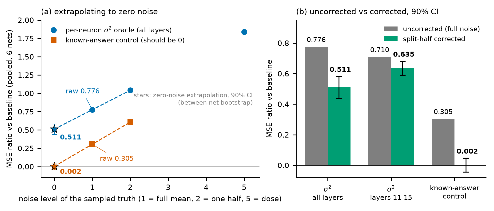
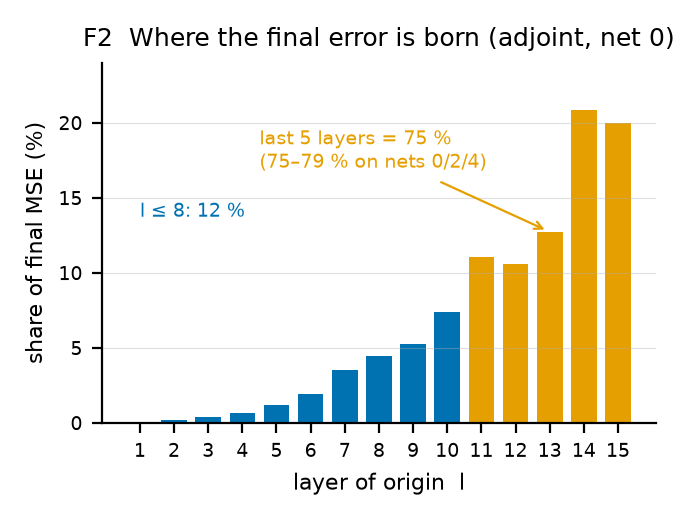

# V31 changelog (from PHASE2_WRITEUP_V30.md, which is frozen and unchanged)

Built 2026-10-22 by a Claude Opus 5.5 agent with `writeup/make_v31.py` from `PHASE2_WRITEUP_V30.md`, following `V30_BENCHMARK.md` §4 and the user's V31 brief. Every edit asserts that its old text occurs exactly once before it is applied; moves cut a block and paste the identical string (headings demoted where stated). No number was added that is not in V30 or in the cited source file. Rows: id | where | old → new | source.

**Length** (`wc`-style word split, text above `## Appendix A`): V30 8981, V31 7482. Whole document: V30 23242, V31 25112.

- **H1** | header | old: '**This document corresponds to one submission: v117_kd, AIcrowd #337578 (graded adjusted 4.00e-9, 0 failed; nominated together with v105_sw #337002, B.4)**, folder `submissions/v117_kd/`, which contains the closure (rules v14 §6). v117_kd is v112_sb (#337384, 4.01e-9, its graded parent) with two constants changed (`writeup/v117_kd_vs_v112.diff`, §7B). v112 is v110_fk (#337268, 4.21e-9) with the old tier on two shared transported bases (§7B); v110 is v105_sw (#337002, 4.24e-9) plus exact extra Winograd levels, and v105 is v99r_rm (#336957, 4.28e-9) plus two exact Σz cuts, all with the same closure; the §6 closure ablation was run on v58_ne (#335139, 4.98e-9). Nominations: B.4. Our then-best build, v101r_xp (4.18e-9), ranked 80 of 300 on 2026-10-18, when the leader was at 1.32e-9 (1.29e-9 in the 2026-10-21 20:34 UTC feed snapshot, C.1), and we do not claim the best estimator.' | new: '**Corresponding submission: v117_kd, AIcrowd #337578, graded 4.00e-9, 0 failed; nominations in B.4.**' | source: PHASE2_WRITEUP_V30.md header (numbers and ids unchanged); the removed lineage is pasted verbatim into B.1 (H2)
- **H2** | Appendix B.1, new first paragraph (lineage moved verbatim from the V30 header) | old: '### B.1 Selected graded ladder (the rows a finding or nomination cites; the full ladder is in `research/rebuild/calibration.jsonl`; all failed = 0 unless noted)⏎' | new: '### B.1 Selected graded ladder (the rows a finding or nomination cites; the full ladder is in `research/rebuild/calibration.jsonl`; all failed = 0 unless noted)⏎⏎**Lineage (moved verbatim from the V30 header in V31).** **This document corresponds to one submission: v117_kd, AIcrowd #337578 (graded adjusted 4.00e-9, 0 failed; nominated together with v105_sw #337002, B.4)**, folder `submissions/v117_kd/`, which contains the closure (rules v14 §6). v117_kd is v112_sb (#337384, 4.01e-9, its graded parent) with two constants changed (`writeup/v117_kd_vs_v112.diff`, §7B). v112 is v110_fk (#337268, 4.21e-9) with the old tier on two shared transported bases (§7B); v110 is v105_sw (#337002, 4.24e-9) plus exact extra Winograd levels, and v105 is v99r_rm (#336957, 4.28e-9) plus two exact Σz cuts, all with the same closure; the §6 closure ablation was run on v58_ne (#335139, 4.98e-9). Nominations: B.4. Our then-best build, v101r_xp (4.18e-9), ranked 80 of 300 on 2026-10-18, when the leader was at 1.32e-9 (1.29e-9 in the 2026-10-21 20:34 UTC feed snapshot, C.1), and we do not claim the best estimator.⏎' | source: PHASE2_WRITEUP_V30.md header, verbatim
- **A1** | Abstract (reordered: measured result first, credit second; narrow novelty; G-RB ids out) | old: 'We built a cumulant-propagation estimator of the per-neuron output mean of random 1024 × 16 ReLU MLPs. **The noise correction used below is not new.** It is the noise-ceiling subtraction of computational neuroscience (Sahani & Linden 2003; Pospisil & Bair 2021), equivalently a two-point Richardson extrapolation in 1/N of a nested Monte-Carlo reading (Rainforth et al. 2018). What is ours, stated narrowly: its application to sampled-truth oracle injection inside a white-box estimator, with a known-answer control (Appendix G: a 21-line scalar toy); the corrector-in-place judging rule (§4); the measured truncation ceiling (§5); and the engineering results (the wall knapsack, §7A, and shared transported bases, §7B). Oracle injection (replacing one internal quantity by sampled ground truth) is a common diagnostic for such estimators (Nurlanggs, forum 18252; Susupro, forum 18254). **When the truth is Monte-Carlo sampled it is biased:** the noise SE is ≈ 0.9 of the chain's own error at z8 and ≈ 0.33 of it at z15, so an uncorrected oracle understates the lever it measures, by an amount that depends on the estimator's accuracy as well as on the sample count. An exact per-neuron σ² reads 0.776 of baseline MSE uncorrected, 0.511 corrected (90 % CI 0.44–0.58; layers 11–15 only 0.635, head frozen); a control that must read ≈ 0 up to the Hermite-truncation floor reads 0.305 uncorrected and 0.002 corrected. **A second trap:** in a chain whose errors cancel internally, a one-quantity oracle measures a lever size, not a fix (§3). **Consequence:** removing every truncation knob in our chain at unlimited cost reaches only 0.815 of raw MSE (0.807 with the head refit): a KILL for those knobs, not a bound on the family. **Engineering:** two shared transported old-tier bases in place of nine per-source bases took graded adjusted 4.21e-9 → 4.01e-9 (v112_sb, AIcrowd #337384, 0 failed, grader wall 87.2 s mean / 95.6 s max; §7B). Two constants on top of it give our corresponding submission, v117_kd #337578 (4.00e-9, 0 failed, grader max wall 89.2 s; §7B, B.4). Bars were pre-registered, with the exceptions listed in the ledger-exceptions paragraph (§8, "Exceptions"); the G-RB144 gate behind v112 is one of them (its bar was derived after G-RB143's data were seen, §7B).' | new: '**When the truth is Monte-Carlo sampled, an oracle reading is biased, and we measured by how much.** In our cumulant-propagation estimator of the per-neuron output mean of random 1024 × 16 ReLU MLPs, an exact per-neuron σ² reads 0.776 of baseline MSE uncorrected, 0.511 corrected (90 % CI 0.44–0.58; layers 11–15 only 0.635, head frozen); a control that must read ≈ 0 up to the Hermite-truncation floor reads 0.305 uncorrected and 0.002 corrected. **The noise correction used is not new.** It is the noise-ceiling subtraction of computational neuroscience (Sahani & Linden 2003; Pospisil & Bair 2021), equivalently a two-point Richardson extrapolation in 1/N of a nested Monte-Carlo reading (Rainforth et al. 2018), and other participants measured or corrected Monte-Carlo noise in their own oracles and references (Nurlanggs, Artyom_Mazur, kai_leal_gonzalez, hyojun_kwon; Appendix I.1). What is ours, stated narrowly and not as a first: two-half extrapolation of the MC noise in the injected quantity, checked by a known-answer control (Appendix G: a 21-line scalar toy), and the measured size of the misreading (0.776 vs 0.511); the corrector-in-place judging rule (§4); the measured truncation ceiling (§5); and the engineering results (the wall knapsack, §7A, and shared transported bases, §7B). Oracle injection (replacing one internal quantity by sampled ground truth) is a common diagnostic for such estimators (Nurlanggs, forum 18252; Susupro, forum 18254). The noise SE is ≈ 0.9 of the chain's own error at z8 and ≈ 0.33 of it at z15, so an uncorrected oracle understates the lever it measures, by an amount that depends on the estimator's accuracy as well as on the sample count. **A second trap:** in a chain whose errors cancel internally, a one-quantity oracle measures a lever size, not a fix (§3). **Consequence:** removing every truncation knob in our chain at unlimited cost reaches only 0.815 of raw MSE (0.807 with the head refit): a KILL for those knobs, not a bound on the family. **Engineering:** two shared transported old-tier bases in place of nine per-source bases took graded adjusted 4.21e-9 → 4.01e-9 (v112_sb, AIcrowd #337384, 0 failed, grader wall 87.2 s mean / 95.6 s max; §7B). Two constants on top of it give our corresponding submission, v117_kd #337578 (4.00e-9, 0 failed, grader max wall 89.2 s; §7B, B.4). Bars were pre-registered, with the exceptions listed in the ledger-exceptions paragraph (§8, "Exceptions"); the gate behind v112 is one of them (its bar was derived after the preceding gate's data were seen, §7B).' | source: PHASE2_WRITEUP_V30.md abstract (every number unchanged: 0.776, 0.511, 0.44–0.58, 0.635, 0.305, 0.002, 0.9, 0.33); credits: research/forum/pdfs_20261022/ndk82I7CUSjB0g4dxOqcdtjmaXg.pdf (Nurlanggs, forum 18252, draft 2026-10-18) p.23; research/forum/pdfs_20261022/pg4mvIMJnQHWhZqnRClIsvC0ooV.pdf (Artyom_Mazur, forum 18249) p.3–4, p.20; research/forum/pdfs_20261022/2Sz9qr3S0AaLcSjksKzXXnPYEVp.pdf (kai_leal_gonzalez, forum 18246) p.2, p.9; research/forum/pdfs_20261022/9NvFSYXNhGpw4QTKxs6dsd6AR1F.pdf (hyojun_kwon, forum 18255, revision of 18 October 2026) p.26–27
- **S1** | Two-page summary, top: prize-criteria map and graded-impact table (condensed from B.0) | old: '## Two-page summary⏎⏎**Corresponding submission:**' | new: '## Two-page summary⏎⏎> **The three prize criteria, one line each.**⏎> (i) **Novelty, narrow:** the noise correction is standard and others handled oracle or truth noise (§1.2); ours is two-half extrapolation of the MC noise in the injected quantity, checked by a known-answer control, and the measured size of the misreading (0.776 vs 0.511), plus two procedural results (§4, §5). ⏎> (ii) **Clarity and accuracy:** each claim carries a tag ([proved], [measured], [argument], [A, unreplicated]) and names its file; bars were pre-registered except the exceptions in §8; proofs carry falsifiers (Appendix P); Appendix E gives the reproduction commands. ⏎> (iii) **Checkable impact:** graded v58_ne 4.98e-9 → v117_kd 4.00e-9 (−19.7 %), from constant screens, exact-cost work and shared transported bases (table below); the only graded step from an algorithmic idea is the §6 closure (−2.3 %, with a corrector refit); the three diagnostics changed what was not built.⏎⏎**Graded impact** (condensed from Appendix B.0; AIcrowd graded adjusted scores).⏎⏎| what | graded step | effect |⏎|---|---|---|⏎| κ4 response closure (§6) | v49 #334744 5.59e-9 → v51 #334768 5.46e-9 | −2.3 %, closure plus a corrector refit; closure-only evidence is ungraded: VALID-20 OFF/ON 1.0327 raw, 17/20 nets worse |⏎| constant screens, one prune change, exact-cost work, wall-budgeted levels (B.0 items 5–7) | v77_fuse #335642 4.92e-9 → v110 #337268 4.21e-9 | −10.4 % through v95 #336648 4.41e-9 (constant screens and the prune); the rest exact-cost and wall work, step by step in B.0 |⏎| shared transported old-tier bases (§7B) | v110 #337268 4.21e-9 → v112_sb #337384 4.01e-9 | −4.8 %, 0 failed; v117_kd #337578 (two constants on top) 4.00e-9, below the meter's resolution |⏎| noise-corrected oracle, corrector-in-place rule, truncation ceiling (§3–5) | none | no graded impact; the rule stopped two shipments (the dense closure and the κ4 predictor) |⏎| head-to-head against the organizers' simple factorized K = 3 (claim 9) | not graded | 0.533× its final-layer MSE (95 % CI 0.49–0.59), lower on 8/8 nets, at 388 vs 3040 n³ FLOPs |⏎⏎**Corresponding submission:**' | source: PHASE2_WRITEUP_V30.md Appendix B.0 items 2, 4, 5, 6, 7, 8, 8b, 9 and claims row 9 (every number and id copied from there; no new number)
- **S2** | after the claims box: duplicate impact pointer removed (its sentence is B.0 item 9 verbatim; the table at the top of the summary replaces the pointer) | old: '> **Measured performance impact on graded submissions** (one entry per idea, with graded ids): Appendix B.0. In short, every graded gain after v58_ne (4.98e-9 → 4.00e-9, −19.7 %) came from constant screens, exact-cost engineering and one near-exact cost cut (shared old-tier bases, raw ×1.0145, §7B); the three transferable findings changed what was *not* built.⏎⏎---⏎⏎⏎' | new: '' | source: PHASE2_WRITEUP_V30.md B.0 item 9 (same sentence, still there)
- **S3** | Summary result 1, second bullet (credit and narrow novelty) | old: '- Two-half Richardson extrapolation removes it. This is the noise-ceiling correction of computational neuroscience; Sahani & Linden 2003 and Rainforth et al. 2018 (Thm 3, its bounded-second-derivative case) are credited.' | new: '- Two-half Richardson extrapolation removes it. This is the noise-ceiling correction of computational neuroscience; Sahani & Linden 2003 and Rainforth et al. 2018 (Thm 3, its bounded-second-derivative case) are credited. Other participants measured or corrected Monte-Carlo noise in their own oracles and references (Nurlanggs, Artyom_Mazur, kai_leal_gonzalez, hyojun_kwon; Appendix I.1). Ours, narrowly: two-half extrapolation of the MC noise in the injected quantity, checked by a known-answer control, and the measured size of the misreading (0.776 vs 0.511).' | source: research/forum/pdfs_20261022/ndk82I7CUSjB0g4dxOqcdtjmaXg.pdf (Nurlanggs, forum 18252, draft 2026-10-18) p.23; research/forum/pdfs_20261022/pg4mvIMJnQHWhZqnRClIsvC0ooV.pdf (Artyom_Mazur, forum 18249) p.3–4, p.20; research/forum/pdfs_20261022/2Sz9qr3S0AaLcSjksKzXXnPYEVp.pdf (kai_leal_gonzalez, forum 18246) p.2, p.9; research/forum/pdfs_20261022/9NvFSYXNhGpw4QTKxs6dsd6AR1F.pdf (hyojun_kwon, forum 18255, revision of 18 October 2026) p.26–27
- **F1a** | Figure 1 (was F0) removed from after the summary | old: '---⏎⏎⏎⏎**F0.** Monte-Carlo noise in a sampled-truth oracle inflates the MSE ratio it reads; split-half extrapolation to zero noise (r∞ = 2·full − mean(A, B)) removes it; this is the same subtraction as the neuroscience noise-ceiling correction (Pospisil & Bair 2021, eqs. 10–11). (a) Pooled raw-MSE ratio vs noise level (1 = full mean, 2 = one half, 5 = ±2 dose; the dose exists for σ² only) for the all-layer σ² oracle (0.776 → 0.511, 90 % CI 0.438–0.581) and the known-answer control, which must read ≈ 0 up to the Hermite-truncation floor and reads 0.305 raw but 0.002 (−0.043–0.046) extrapolated. **The control has only two noise points, so its extrapolation is a two-point line with no dose check.** (b) Uncorrected vs corrected for σ² all layers, σ² layers 11–15 (0.710 → 0.635 [0.589, 0.680]) and the control; CIs are a between-net bootstrap over six nets (tails understated). Source: `research/rb119/ci119.json`, recomputed by `figs/make_f0_oracle_bias.py`. Gate: G-RB119.⏎⏎' | new: '' | source: PHASE2_WRITEUP_V30.md, moved by F1b
- **F1b** | Figure 1 (was F0) placed directly after summary result 1; label F0 → Figure 1 (caption otherwise verbatim) | old: '**2. The final layer is quadratically hypersensitive to coherent σ² error' | new: '⏎⏎**Figure 1.** Monte-Carlo noise in a sampled-truth oracle inflates the MSE ratio it reads; split-half extrapolation to zero noise (r∞ = 2·full − mean(A, B)) removes it; this is the same subtraction as the neuroscience noise-ceiling correction (Pospisil & Bair 2021, eqs. 10–11). (a) Pooled raw-MSE ratio vs noise level (1 = full mean, 2 = one half, 5 = ±2 dose; the dose exists for σ² only) for the all-layer σ² oracle (0.776 → 0.511, 90 % CI 0.438–0.581) and the known-answer control, which must read ≈ 0 up to the Hermite-truncation floor and reads 0.305 raw but 0.002 (−0.043–0.046) extrapolated. **The control has only two noise points, so its extrapolation is a two-point line with no dose check.** (b) Uncorrected vs corrected for σ² all layers, σ² layers 11–15 (0.710 → 0.635 [0.589, 0.680]) and the control; CIs are a between-net bootstrap over six nets (tails understated). Source: `research/rb119/ci119.json`, recomputed by `figs/make_f0_oracle_bias.py`. Gate: G-RB119.⏎⏎**2. The final layer is quadratically hypersensitive to coherent σ² error' | source: PHASE2_WRITEUP_V30.md F0 image line and caption, verbatim except the label
- **S4** | Summary result 2, [inference] bullet: related Phase 2 work (Mazur Proposition 1; abhimanyu_singh) and a pointer to the consistency note | old: '- We read this as: the coherent part of the σ² error is already at its optimum, so what σ² error remains is incoherent per-neuron error, which a better covariance closure, not better constants, would have to remove [inference]. Exact σ² would leave 0.51× of raw, so σ² is not the only remaining error.' | new: '- We read this as: the coherent part of the σ² error is already at its optimum, so what σ² error remains is incoherent per-neuron error, which a better covariance closure, not better constants, would have to remove [inference]. Exact σ² would leave 0.51× of raw, so σ² is not the only remaining error. Related: Artyom_Mazur's Proposition 1 (forum 18249, p.19) makes a neuron's next-layer variance error a coherent level from tr ΔC plus noise independent across neurons, and a model of the neuron's own state cannot see that noise (p.20); abhimanyu_singh (forum 18264, prose; n = 256) measures a quadratic law for iid noise on the D21 and D3 slice read-outs (added MSE ≈ 0.91σ² and 0.60σ²) and finds that bias propagates while zero-mean noise attenuates. A consistency note on the leader's raw MSE is in §7C.' | source: research/forum/pdfs_20261022/pg4mvIMJnQHWhZqnRClIsvC0ooV.pdf (Artyom_Mazur, forum 18249) p.1 item 1, p.19 Proposition 1, p.20 Consequence 1; forum topic 18264 post #1 (abhimanyu_singh, 2026-10-21T11:27Z), public Discourse JSON read 2026-10-22, prose only §2 and §4
- **S5** | Summary result 2: 'Consistency note … may be coincidence' bullet removed (it remains in §7C 'Reading' and C.1) | old: '- Consistency note, not a proof: the leader's graded raw MSE over ours, 1.09e-8 / 2.13e-8 = 0.51 (grader feed snapshot 2026-10-21 20:34 UTC, frozen as `writeup/proofs/p2_rows_20261021T2034Z.json`, sha256 321f94476625cd18ac7f63a3fe726770139a9a81aafcf3e6c9d1ed3b604120c0), is close to our exact-σ² oracle, 0.51. The two are measured on different chains and nets; this may be coincidence.⏎' | new: '' | source: PHASE2_WRITEUP_V30.md §7C 'Reading [inference]' (same note, kept)
- **S6** | Summary result 3, credit bullet: Mazur item 4 added; 'plus the noise-corrected reading' dropped (that claim is result 1's) | old: 'and in Phase 2 by Nurlanggs (forum 18252). We credit them. Ours are the measured n = 1024, depth-16 instances, plus the noise-corrected reading.' | new: 'and in Phase 2 by Nurlanggs (forum 18252) and Artyom_Mazur (forum 18249, item 4, p.2: exact variance alone made the result worse, ×1.09, while exact variance, κ3 and κ4 together gave ×0.12). We credit them. Ours are the measured n = 1024, depth-16 instances.' | source: research/forum/pdfs_20261022/pg4mvIMJnQHWhZqnRClIsvC0ooV.pdf (Artyom_Mazur, forum 18249) p.2 item 4
- **S7** | §3 'The principle, with its two measured instances' (same sentence as S6, kept consistent) | old: 'and in Phase 2 by Nurlanggs (forum 18252). We credit them. Ours are the measured n = 1024, depth-16 instances, plus the noise-corrected reading.' | new: 'and in Phase 2 by Nurlanggs (forum 18252) and Artyom_Mazur (forum 18249, item 4, p.2: exact variance alone made the result worse, ×1.09, while exact variance, κ3 and κ4 together gave ×0.12). We credit them. Ours are the measured n = 1024, depth-16 instances.' | source: research/forum/pdfs_20261022/pg4mvIMJnQHWhZqnRClIsvC0ooV.pdf (Artyom_Mazur, forum 18249) p.2 item 4
- **M1** (move) | Summary 'What did not work' and 'What we would try next' → new Appendix F.8 (paragraphs verbatim; headings demoted ### → ####) | moved block: '### What did not work (measured, so nobody needs to repeat it)⏎An exact (2,2)-slice κ4 oracle (0.953 at layers 8-14, against a 0.85 bar; exact h-side transport ×1.5 worse), the dense WᵀW closure mode with Λ refit (0.9985, +~4 % util, hand estimate; not metered), corrector (head) refits after a chain change (≈ 1.00 six times: G-RB18, G-RB29, G-RB61 ×2, G-RB76 1.005, G-RB151 1.004; G-RB120's refit moved 1 %), old-tier damping, σ² calibration channels (1.10-1.18), larger shared ranks (a tail blow-up on one MLP), and Strassen-depth variants (failed remote_check: arena KeyError, shape assertion; not measured). The ledger lists all ~160 gates (`research/rebuild/gates.jsonl`, 162 records) with their bars, pre-registered except where §8 'Exceptions' says otherwise.⏎⏎### What we would try next⏎Gaussian-copula pair moments with exact Edgeworth marginals, non-perturbative in ρ (proposed by an LLM council, G-RB156). This targets the incoherent per-neuron σ² error that result 2 points to.⏎⏎' | left in place: '**What did not work, and what we would try next:** Appendix F.8, with other negatives in F.0.⏎⏎' | source: PHASE2_WRITEUP_V30.md two-page summary
- **F2a** | §2: figure F2 and its one-line caption moved to Appendix F.9 | old: '⏎⏎**F2.** Share of final-layer MSE by layer of origin (diagonal adjoint, net 0).⏎⏎' | new: '' | source: PHASE2_WRITEUP_V30.md §2
- **F2b** | Appendix F.9 (new): Figure 3 (was F2) with a full caption built from §2's own text | old: '## Appendix G. A scalar toy of the oracle noise bias' | new: '### F.9 Figure 3: error origin by layer (moved from §2 in V31)⏎⏎⏎⏎**Figure 3.** Share of final-layer MSE by layer of origin (diagonal adjoint, net 0) [A, unreplicated]. Each layer's local residual is weighted by gain_l, the mean squared column norm of its adjoint T_l; uncorrected f64 chain, no closure, K = 2 gates, age 5. Shares and caveats in §2.⏎⏎## Appendix G. A scalar toy of the oracle noise bias' | source: PHASE2_WRITEUP_V30.md §2 'Diagonal adjoint attribution' (gain_l definition; 'uncorrected f64 chain, no closure, K = 2 gates, FIT 0/2/4, age 5'; tag [A, unreplicated])
- **F2c** | §2 figure reference | old: 'layers ≤ 2 ≤ 0.2 % (uncorrected f64 chain, no closure, K = 2 gates, FIT 0/2/4, age 5; F2).' | new: 'layers ≤ 2 ≤ 0.2 % (uncorrected f64 chain, no closure, K = 2 gates, FIT 0/2/4, age 5; Figure 3, Appendix F.9).' | source: renumbering
- **F3a** | §6 figure reference | old: '17 of 20 nets worse (F3, Appendix B)' | new: '17 of 20 nets worse (Figure 2, Appendix B.1)' | source: renumbering
- **F3b** | B.1 figure alt text | old: '![F3 — closure OFF/ON on v58_ne]' | new: '![Figure 2 — closure OFF/ON on v58_ne]' | source: renumbering
- **F3c** | B.1 caption label | old: '**F3.** Per-net raw-MSE ratio' | new: '**Figure 2.** Per-net raw-MSE ratio' | source: renumbering
- **F6a** | claims-box pointer to Appendix H | old: 'and the F6 oracle/ceiling ladder:** Appendix H.' | new: 'and the oracle/ceiling ladder (Figure 4):** Appendix H.' | source: renumbering
- **F6b** | Appendix H title | old: '## Appendix H. Oracle method box, recipe and the F6 ladder (moved from the V29 front matter)' | new: '## Appendix H. Oracle method box, recipe and the oracle/ceiling ladder, Figure 4 (moved from the V29 front matter)' | source: renumbering
- **F6c** | Appendix H alt text | old: '![F6 — oracle and ceiling ladder]' | new: '![Figure 4 — oracle and ceiling ladder]' | source: renumbering
- **F6d** | Appendix H caption label | old: '**F6.** Pooled final raw MSE vs the twin' | new: '**Figure 4.** Pooled final raw MSE vs the twin' | source: renumbering
- **F0a** | Appendix E step 2 comment | old: 'control 0.305 → 0.002 [−0.043,0.046] (§3 table, F0)' | new: 'control 0.305 → 0.002 [−0.043,0.046] (§3 table, Figure 1)' | source: renumbering
- **F0b** | §7C 'Related observation' figure reference | old: 'his probe-noise decomposition is a cousin of our F0 noise correction.' | new: 'his probe-noise decomposition (p.9) is a cousin of our noise correction (Figure 1).' | source: renumbering; page from research/forum/pdfs_20261021/1r2sLiRMQPPB0n1X5ynuhid2RC.pdf (James Henry, topic 18097, rev. with erratum 2026-08-04) p.9
- **N1** | §1.2 'New here, narrowly' (narrow novelty; the false 'found no prior application' sentence removed; credits) | old: '**New here, narrowly:** applying it to a diagnostic that had not used it, the oracle injection of sampled truth into a white-box estimator, with a known-answer control (§3). A literature search found no prior application of it to oracle injection in the organizers' paper, code or blog, or in the forum prose we read.' | new: '**Ours, narrowly and not as a first:** two-half extrapolation of the MC noise in the injected quantity, checked by a known-answer control, and the measured size of the misreading (0.776 vs 0.511; §3). Others handled Monte-Carlo noise in their own oracles and references: Nurlanggs measured his oracle's noise floor, Artyom_Mazur subtracts oracle noise measured from two seeds in his substitutions, kai_leal_gonzalez estimated his truth reference's noise and hyojun_kwon split-half-corrected his, and James Henry (Phase 1) decomposed his probe noise (pages in Appendix I.1).' | source: research/forum/pdfs_20261022/ndk82I7CUSjB0g4dxOqcdtjmaXg.pdf (Nurlanggs, forum 18252, draft 2026-10-18) p.23; research/forum/pdfs_20261022/pg4mvIMJnQHWhZqnRClIsvC0ooV.pdf (Artyom_Mazur, forum 18249) p.3–4, p.19–20; research/forum/pdfs_20261022/2Sz9qr3S0AaLcSjksKzXXnPYEVp.pdf (kai_leal_gonzalez, forum 18246) p.2; research/forum/pdfs_20261022/9NvFSYXNhGpw4QTKxs6dsd6AR1F.pdf (hyojun_kwon, forum 18255, revision of 18 October 2026) p.26–27; research/forum/pdfs_20261021/1r2sLiRMQPPB0n1X5ynuhid2RC.pdf (James Henry, topic 18097, rev. with erratum 2026-08-04) p.9
- **N2** | §1.2 'Not new' list | old: '**Not new:** oracle injection itself,' | new: '**Not new:** correcting oracle or truth noise as such, oracle injection itself,' | source: brief, item 1
- **N3** | §1.2 credit list | old: 'Every other credit (ARC, Team Puffi, Team 504aldo, Nurlanggs, Susupro, hyojun_kwon, other participants, textbooks)' | new: 'Every other credit (ARC, Team Puffi, Team 504aldo, Nurlanggs, Susupro, Artyom_Mazur, kai_leal_gonzalez, hyojun_kwon, James Henry, abhimanyu_singh, other participants, textbooks)' | source: Appendix I.1 as amended (N6–N8)
- **N4** | §1A stub removed (it was a pointer only; §1.2 already points to Appendix I) | old: '## 1A. Related work⏎⏎Moved to Appendix I in V30 (for length). §1.2 names the sources of the noise correction; Appendix I.1 itemises every other credit.⏎⏎---⏎⏎' | new: '' | source: PHASE2_WRITEUP_V30.md
- **N5** | §3 'Provenance first' (narrow novelty, consistent with §1.2) | old: 'What this section adds is its application to sampled-truth oracle injection in a white-box estimator, a known-answer control, and the readings below (Appendix I has the sources).' | new: 'What this section adds, narrowly and not as a first, is two-half extrapolation of the MC noise in the injected quantity, checked by a known-answer control, and the measured size of the misreading (0.776 vs 0.511); others' handling of oracle and truth noise is credited in Appendix I.1, and Appendix I has the sources.' | source: brief, item 1
- **C1** | Claims box row 1 (narrow novelty) | old: 'Known-answer control 0.305 uncorrected, 0.002 corrected (vs the head-ON twin). |' | new: 'Known-answer control 0.305 uncorrected, 0.002 corrected (vs the head-ON twin). The correction is standard and others handled oracle or truth noise (Appendix I.1); ours, narrowly: two-half extrapolation of the MC noise in the injected quantity, its known-answer control and the measured size of the misreading. |' | source: brief, item 1
- **C2** | Claims box row 2 (Mazur item 4) | old: 'The principle was stated publicly earlier (Henry, Pepper, Nurlanggs; §3);' | new: 'The principle was stated publicly earlier (Henry, Pepper, Nurlanggs; in Phase 2 also Artyom_Mazur, forum 18249, item 4 p.2: exact variance alone ×1.09, with κ3 and κ4 ×0.12; §3);' | source: research/forum/pdfs_20261022/pg4mvIMJnQHWhZqnRClIsvC0ooV.pdf (Artyom_Mazur, forum 18249) p.2 item 4
- **N6** | Appendix I intro (V31 sources) | old: '(`writeup/DRAFT_RELATED_WORK.md` lists what it read and what it could not reach); I read none of them.' | new: '(`writeup/DRAFT_RELATED_WORK.md` lists what it read and what it could not reach); I read none of them. The credits added in V31 (I.1, "Monte-Carlo noise") were read by a Claude agent from the participants' PDFs in `research/forum/pdfs_20261021/` and `pdfs_20261022/` and from forum prose; no participant code was opened.' | source: V31 process
- **N7** | Appendix I.1, Susupro/Nurlanggs bullet: the inaccurate 'as far as the posts show, not noise-corrected' sentence rewritten | old: 'Nurlanggs's tables are oracle injections with sampled truth like ours and, as far as the posts show, not noise-corrected; our correction is complementary.' | new: 'Nurlanggs's tables are oracle injections with sampled truth like ours, and his PDF measures the noise: a 16M-path oracle carries a +4.2e-9 MSE floor on its own net (var_h / N), and scoring injections against the oracle's own paths reads 0.564 against 0.520 when scored against the organizers' independent 1e9-path truth (forum 18252, p.23; the injections are on p.7). His remedy is to score against the independent truth ("use them as the metric", p.23); ours extrapolates away the noise in the injected quantity itself.' | source: research/forum/pdfs_20261022/ndk82I7CUSjB0g4dxOqcdtjmaXg.pdf (Nurlanggs, forum 18252, draft 2026-10-18) p.7, p.23 (also p.15 timeline and p.28 table)
- **N8** | Appendix I.1: new bullet crediting Monte-Carlo noise handling and two related Phase 2 results | old: '- **Others (prose):** marius_binner (fire-rate pruning),' | new: '- **Monte-Carlo noise in oracles and references (read from the PDFs in V31).**⏎  - *Artyom_Mazur (forum 18249).* His oracle substitutions use 10⁷ samples with two independent seeds "so that the oracle's own noise can be measured and subtracted" (p.4; also p.3). He reports an "exact" covariance substitution that read worse because its 4·10⁶-sample oracle's noise was coherent (p.19, N50), an off-diagonal-covariance payoff of ×0.55–0.68 "noise-corrected two ways" (p.20), and a split-half noise ceiling of 0.87–0.98 for his linear model of the covariance error (p.20). This is the closest public work to our correction: noise measured from two seeds and subtracted in the substituted quantity. Ours, narrowly: two-half extrapolation of the MC noise in the injected quantity, checked by a known-answer control, and the measured size of the misreading (0.776 vs 0.511); unlike his subtraction it is a two-point extrapolation with a 5× dose check. His item 4 (p.2) states the compensation principle (exact variance alone ×1.09, variance, κ3 and κ4 together ×0.12; summary result 3), and his Proposition 1 (p.19) the coherent-plus-independent structure of per-neuron variance error (summary result 2).⏎  - *kai_leal_gonzalez (forum 18246).* Estimates the noise of the organizers' truth, his dumps and an independent bake from three independent estimates (p.2), and notes that injected slices carry Monte-Carlo noise, so oracle gains are "if anything, understated" (p.9), the direction we measured.⏎  - *hyojun_kwon (forum 18255, revision of 18 October).* Gates scored against "split-half-corrected Monte Carlo references" (p.27; split-half noise subtraction, p.26).⏎  - *James Henry (Phase 1, topic 18097, #314695, rev. 2026-08-04).* Decomposes per-seed final MSE into bias² plus across-seed variance, correcting the K-seed mean's residual noise by /K (p.9).⏎  - *abhimanyu_singh (forum 18264, prose).* A quadratic law for iid noise on the D21 and D3 slice read-outs (added MSE ≈ 0.91σ² and 0.60σ², n = 256) and a bias/variance asymmetry: truncation bias propagates while zero-mean noise attenuates (summary result 2).⏎- **Others (prose):** marius_binner (fire-rate pruning),' | source: research/forum/pdfs_20261022/pg4mvIMJnQHWhZqnRClIsvC0ooV.pdf (Artyom_Mazur, forum 18249) p.2–4, p.19–20; research/forum/pdfs_20261022/2Sz9qr3S0AaLcSjksKzXXnPYEVp.pdf (kai_leal_gonzalez, forum 18246) p.2, p.9; research/forum/pdfs_20261022/9NvFSYXNhGpw4QTKxs6dsd6AR1F.pdf (hyojun_kwon, forum 18255, revision of 18 October 2026) p.26–27; research/forum/pdfs_20261021/1r2sLiRMQPPB0n1X5ynuhid2RC.pdf (James Henry, topic 18097, rev. with erratum 2026-08-04) p.9; forum topic 18264 post #1 (abhimanyu_singh, 2026-10-21T11:27Z), public Discourse JSON read 2026-10-22, prose only
- **N9** | Appendix I.2, Nurlanggs truth-set paragraph (his own noise-floor measurement) | old: 'This is not a controlled dose comparison or an external confirmation; we did not re-measure their chains [H].' | new: 'This is not a controlled dose comparison or an external confirmation; we did not re-measure their chains [H]. His PDF measures that oracle's own noise floor, +4.2e-9 (forum 18252, p.23; I.1).' | source: research/forum/pdfs_20261022/ndk82I7CUSjB0g4dxOqcdtjmaXg.pdf (Nurlanggs, forum 18252, draft 2026-10-18) p.23
- **M2** (move) | §10 body (two paragraphs) → new Appendix K, verbatim; §10 replaced by a five-bullet summary naming every model and council | moved block: 'Every draft of this document and the submitted code from v21_rb onward were written by Anthropic Claude models (Claude Fable 5.1 and Claude Opus 5.5; Opus for review, claim auditing and the V30 assembly) running as Claude Code agents that I orchestrated; the graded v11_sw (#334046) was built by a Hermes coding agent (kimi-k2.7-code) around a Claude-written Strassen kernel. I set the goals and guardrails (source rule, pre-registration, ship bars), approved or declined each submission, chose which to submit and designate, and wrote none of the code or prose myself. I have not independently re-derived the mathematics: Appendix D.2, the F.0 identities and §7 are agent derivations (D.2's identity and the §7B Gram-solve projection now also have machine checks with falsifiers, Appendix P, likewise written and run by agents); only T1's structural statements (G-RB80) and the F.3 results with failing perturbed variants meet the [proved] bar. Every measurement was run by an agent and most trace to a ledger gate; the adjoint attribution (§2), the −20.2 % corrector figure (§4) and the F.3 checks trace only to `LENS_B_math.md`, `LENS_D_redteam.md` and `research/PROOFS.md`. I re-ran none of them. Adversarial review was by agents (Claude, Ollama Cloud and local open-weight councils), not by me. V16–V30 were each edited by a Claude agent from the previous version (`writeup/V29_CHANGELOG.md`, `writeup/V30_CHANGELOG.md`). For V30, Claude agents audited the inserted drafts (the summary, Appendix P) against their source files twice (`writeup/V30_CLAIM_AUDIT.md`, `V30_REVERIFY.md`; workspace files, not shipped), wrote the Appendix P proofs and checks, assembled this version, and re-ran Appendix E from a fresh unzip (`writeup/V30_REPRO_FINAL.md`, next to the zip). Text written during assembly (the header, abstract and claims rows 8–9, §7B's v117_kd paragraph, §7C, A.1, B.0 items 8–9, B.1, B.4, C.1, I.2's regime caveats, Appendix E, §9 item 5 and this section) was then fact-checked once by an independent Claude agent (`writeup/V30_ASSEMBLY_AUDIT.md`, workspace file, not shipped); its corrections were applied. Three Ollama-cloud model councils (G-RB150: kimi and deepseek, glm timed out; a ~04Z council on the leaders' score histories, which proposed §7C's old-tier damping arm and its consistency note; G-RB156: kimi, deepseek, glm) were used for ideas only, each checked against the ledger; all our own runs were local, and graded scores and wall times are the grader's; the related-work search (Appendix I) was run by a Claude agent, and sources it could not reach are marked UNKNOWN in its log; the toy script of Appendix G was written and run by an agent.⏎⏎**Uncertain:** the MIX2 corrector is unexplained; T2 is an argument; the adjoint attribution is unreplicated; the σ² seat is an oracle (a lever size, not a construction); the claim that Nurlanggs's 16M-path oracle tables are noise-biased is a hypothesis [H] we did not test (his two truth sets agree in direction for 2 of 3 quantities, nothing more); the constants re-tune on the untruncated chain is untested; [derived] and [argument] items were not machine-checked.⏎' | left in place: '- **Writing and code.** Anthropic Claude models (Claude Fable 5.1 and Claude Opus 5.5), running as Claude Code agents that I orchestrated, wrote every draft of this document and the submitted code from v21_rb onward; the graded v11_sw (#334046) was built by a Hermes coding agent (kimi-k2.7-code) around a Claude-written Strassen kernel. I wrote none of the code or prose.⏎- **Decisions.** I set the goals and guardrails (source rule, pre-registration, ship bars), approved or declined each submission, and chose which to submit and designate.⏎- **Checks.** Every measurement and proof check was run by an agent; I re-ran none of them and have not independently re-derived the mathematics. Claude agents audited V30 against its source files and re-ran Appendix E from a fresh unzip; V16–V31 were each edited by a Claude agent from the previous version (`writeup/V31_CHANGELOG.md`).⏎- **Councils, for ideas only, each checked against the ledger.** Three Ollama-cloud model councils (kimi and deepseek, glm timed out; a ~04Z council on the leaders' score histories; kimi, deepseek and glm, whose GLM-5.3 proposed §7C's copula idea). Adversarial review was by agents (Claude, Ollama Cloud and local open-weight councils), not by me.⏎- **Full disclosure and the list of uncertain items:** Appendix K.⏎' | source: PHASE2_WRITEUP_V30.md §10 (every model and council named there is named in the short text: Claude Fable 5.1, Claude Opus 5.5, Hermes kimi-k2.7-code, the three Ollama-cloud councils with kimi/deepseek/glm and GLM-5.3 from §7C, local open-weight councils)
- **K1** | Appendix K 'Uncertain' list (logged correction after the verbatim move): Nurlanggs measured his oracle's noise floor | old: '(his two truth sets agree in direction for 2 of 3 quantities, nothing more);' | new: '(his two truth sets agree in direction for 2 of 3 quantities, nothing more; his PDF, forum 18252 p.23, measures that oracle's own noise floor, +4.2e-9);' | source: research/forum/pdfs_20261022/ndk82I7CUSjB0g4dxOqcdtjmaXg.pdf (Nurlanggs, forum 18252, draft 2026-10-18) p.23
- **L0** | §7B: obsolete pointer bullet '- *Port bars:* Appendix F.7' deleted before the ladder moved into F.7 itself (port bars are already in F.7) | old: '⏎- *Port bars:* Appendix F.7 (moved in V30 for length).⏎' | new: '⏎' | source: V30 F.7 (port bars already there)
- **M3** (move) | §7B 'Evidence ladder' (heading and its 3 gate bullets; the 4th, a pointer to F.7, was deleted by L0) → Appendix F.7, verbatim; replaced by a 3-sentence pointer | moved block: '**Evidence ladder.**⏎- *G-RB142 step 0 (proxy KILL).* Rule: KILL if the residual outside the fixed Q exceeds 3× the entrant's own top-384 residual at any layer ≥ 8. The ratio was 5.0–5.2 at l8 and 8.4–8.6 at l14, because each own basis sharpened with age while the shared residual stayed flat (3–4 % in norm). **Lesson: gate on the end-to-end quantity, not on a proxy against a moving baseline.**⏎- *G-RB143 (end-to-end).* Valid instrument (A0 bit-identical at OMP 2; A3 0.9746; random Q 2.50; M2 diverges). Raw FIT12 1.0192, VALID-20 1.0277 (20/20 nets ≤ 1.10). Metered saving S = 1.228 pt (20.2051 → 18.9772) against a ≥ 1.5 clause: **a KILL on its cost leg, and it stays one**, although its adjusted clause passed (0.9653).⏎- *G-RB144 (unseen nets).* G-RB143 failed its metered-cost clause (S = 1.228 < 1.5 pt) and stays a KILL. G-RB144 was then registered on G-RB143's passing adjusted clause only (bar: held-out raw ≤ 1.038 = 0.975 × 20.2051/(20.2051 − 1.228), with ≥ 24/40 nets ≤ 1.10), with the failed cost clause dropped and after FIT12 1.0192 and VALID-20 1.0277 had been seen, so a reading near those values was expected to pass. It was judged on 40 nets the A2 arm had never touched (ids 1300–1339): pooled raw 1.0145, 40/40 ≤ 1.10, worst 1.064, 11/40 improve; A0 matched the shipped control bit-identically. The held-out nets are genuinely held out and the graded 4.01e-9 stands, but the gate was not pre-registered in the strict sense: its bar was derived from data already seen. The decision to ship rests on this held-out read and the slot rule; the cost bar it replaced was not met.⏎⏎' | left in place: '**Evidence ladder** (Appendix F.7). A proxy gate was a KILL; the end-to-end gate passed its adjusted clause (0.9653) but failed its metered-cost clause (S = 1.228 < 1.5 pt) and stays a KILL; the gate that admitted v112 was registered on the passing clause after those reads (an exception, §8) and passed on 40 unseen nets (pooled raw 1.0145, 40/40 ≤ 1.10, worst 1.064).⏎⏎' | source: PHASE2_WRITEUP_V30.md §7B (pointer numbers: 0.9653, 1.228, 1.5, 1.0145, 40/40, 1.064, all from the moved bullets)
- **M4** (move) | §7B 'The corresponding submission, v117_kd #337578' paragraph → Appendix F.7, verbatim; replaced by a 2-sentence summary | moved block: '**The corresponding submission, v117_kd #337578.** v117_kd is v112_sb with two constants changed and identical weight files (`writeup/v117_kd_vs_v112.diff`): the order `_KH` of the Price–Mehler pair series in the n×n ReLU closure (F.3), 4 → 3 (the per-neuron Hermite recursion depth `_KGC = _KH + 4` moves 8 → 7 with it), and the deep-layer corrector factor (layers 8–14; the last-layer head is unchanged) 0.9 → 0.95. Graded 4.00e-9 (predicted 4.00e-9) against v112's 4.01e-9; worst public MLP 4.98e-9 against 4.99e-9; grader wall max 89.2 s against 95.6 s; 0 failed (`research/R2_GO_NOGO.md`, G-RB157 and its addendum; `writeup/USER_DECISIONS.md`, 2026-10-21 ~19:20Z, a workspace file not shipped). **Selection disclosure.** It combines the best two of six one-constant variants of v112 scored on the same 3 meter nets (VALID 10/13/16; `writeup/proofs/meter3.py`, `meter117.out`), so its meter reading is selection-biased. Afterwards 13 more single-knob variants (of v112 or of v117_kd) were run on those nets: 10 gave readings (`meter119.out`, `meter121.out`–`meter123.out`) and 3 crashed or ran out of memory. v120_kdl's reading is not in a shipped file, and four earlier probes were metered on net 0 only (`meter116.out`). None of them was nominated. It is tied with v120_kdl #337587 (v117_kd + LITE ×0.9; also 4.00e-9; worst MLP 5.04e-9, wall max 93.2 s). **Counterexamples.** Two later variants, v122_rk3 #337610 and v123_rk3lt #337612, both graded 4.02e-9 although the 3-net meter read 0.9994 and 0.9987 against v117_kd (`research/rebuild/calibration.jsonl` l.67–70). The 3-net meter therefore cannot rank builds whose readings differ by less than about 0.3 %, and v117_kd's 0.1 % score gain over v112 (public 4.001e-9 against 4.005e-9) is below that resolution; its wall gain (89.2 s against 95.6 s max) is one grader reading. We cite v117_kd as the nominated build, not as evidence of a better method.⏎' | left in place: '**The corresponding submission, v117_kd #337578,** is v112_sb with two constants changed (pair-series order `_KH` 4 → 3, deep-layer corrector 0.9 → 0.95; `writeup/v117_kd_vs_v112.diff`): graded 4.00e-9 against 4.01e-9, grader wall max 89.2 s against 95.6 s, 0 failed. It combines the best two of six one-constant variants scored on 3 meter nets, and that meter cannot rank builds closer than about 0.3 %, so we cite v117_kd as the nominated build, not as evidence of a better method (selection disclosure and counterexamples: Appendix F.7).⏎' | source: PHASE2_WRITEUP_V30.md §7B (summary numbers: 4.00e-9, 4.01e-9, 89.2 s, 95.6 s, six variants, 3 nets, 0.3 %, all from the moved paragraph)
- **G1** | §2 | old: 'skipping the layer-1 birth gave raw ×10.2 (G-RB93).' | new: 'skipping the layer-1 birth gave raw ×10.2 (Appendix F.0).' | source: F.0 table row (same reading)
- **G2** | §3 noise-correction label | old: '*Noise correction (G-RB119).* Each oracle' | new: '*Noise correction.* Each oracle' | source: id removal
- **G3** | §3 | old: 'G-RB117's averaged-halves ratios (σ² 0.776,' | new: 'The uncorrected averaged-halves ratios (σ² 0.776,' | source: id removal
- **G4** | §3 | old: 'at layers 11–15 only, 0.635× [0.589, 0.680] (G-RB119b), about 75 %' | new: 'at layers 11–15 only, 0.635× [0.589, 0.680], about 75 %' | source: id removal
- **G5** | §3 | old: '**Withdrawn:** G-RB117's rule "exact σ² > 0.62' | new: '**Withdrawn:** the §5 gate's rule "exact σ² > 0.62' | source: id removal (G-RB117 is the §5 experiment)
- **G6** | §3 bullet | old: '- **σ² (G-RB86).** σ² =' | new: '- **σ².** σ² =' | source: id removal (still in claims row 2 and the §4 table)
- **G7** | §3 bullet | old: '- **κ4 (G-RB73).** A per-neuron' | new: '- **κ4 (§4, row 4).** A per-neuron' | source: id removal
- **G8** | §5 | old: '**The experiment (G-RB117, pre-registered).**' | new: '**The experiment (pre-registered).**' | source: id removal
- **G9** | §5 | old: 'so G-RB120 refit the head on the untruncated chain' | new: 'so a second gate refit the head on the untruncated chain' | source: id removal
- **G14** | §7B Idea | old: 'G-RB2 had measured shared r384' | new: 'An early gate had measured shared r384' | source: id removal
- **G15** | §7B Idea | old: 'and G-RB143 reads R ≈ 0.45, the first old-tier cut below 1.' | new: 'and the end-to-end gate (Appendix F.7) reads R ≈ 0.45, the first old-tier cut below 1.' | source: id removal
- **G16** | §7C | old: '**VSE1 (G-RB153):** Appendix F.7' | new: '**VSE1:** Appendix F.7' | source: id removal
- **M5** (move) | §7C 'Old-tier damping' and 'Reading [inference]' paragraphs → Appendix F.7 (verbatim; the Reading carries the F0b renumbering) | moved block: '**Old-tier damping (G-RB153, arms OD).** Scaling the transported old tier by α reads α = 0 22.6, 0.5 6.45, 0.8 1.91, 0.9 1.25, 1.2 1.75; 0/12 nets improve in any arm. No tested α beats α = 1; a quadratic through 0.9, 1 and 1.2 puts the optimum within 0.01 of 1. An Ollama-cloud model council had proposed an interior optimum in retained old content (the "council2 hypothesis" of the G-RB153 verdict); in our family it is falsified.⏎⏎**Reading [inference].** The coherent part of the σ² error is already at its optimum, so what σ² error remains is incoherent per-neuron error, which a better covariance closure, not better constants, would have to remove. Exact σ² would leave 0.51× of raw (§3), so σ² is not the only remaining error. *Consistency note, not a proof:* the leader's graded raw MSE over ours is 1.09e-8 / 2.13e-8 = 0.51 (grader feed snapshot 2026-10-21 20:34 UTC, `writeup/proofs/p2_rows_20261021T2034Z.json`), close to our exact-σ² oracle, 0.51; the two are measured on different chains and nets, and this may be coincidence (first raised by a model in the ~04Z council, §10). *Related observation:* James Henry (#314695, rev. 2026-08-04, p.10) reports a 16:1 bias:variance asymmetry against a shrink filter at 256 × 32; his probe-noise decomposition (p.9) is a cousin of our noise correction (Figure 1).⏎⏎' | left in place: '**Old-tier damping and the reading [inference], with its consistency note on the leader's raw MSE:** moved verbatim to Appendix F.7 in V31; summary result 2 states both.⏎⏎' | source: PHASE2_WRITEUP_V30.md §7C | destination: before '### F.8 What did not work, and what we would try next'
- **M6** (move) | §7C 'What we would try next' paragraph → Appendix F.7 (verbatim) | moved block: '**What we would try next.** Gaussian-copula pair moments with exact (Edgeworth) marginals, non-perturbative in ρ, in place of our truncated Price–Mehler pair closure (F.3; order 3 in v117_kd, order 4 in v112). It targets the incoherent per-neuron σ² error above. The idea is a model suggestion, not ours: GLM-5.3 proposed it in an Ollama-cloud council of three models (G-RB156), whose other proposals were either already measured in our ledger (the transported pair-kurtosis matrix, G-RB90) or variants of the same copula idea. A related measured bound: an exact (2,2)-slice κ4 oracle reads only 0.953 at layers 8–14 against a 0.85 bar, and exact h-side transport is ×1.5 worse (G-RB90).⏎' | left in place: '**What we would try next:** moved verbatim to Appendix F.7 in V31 (summary version in F.8).⏎' | source: PHASE2_WRITEUP_V30.md §7C | destination: before '### F.8 What did not work, and what we would try next'
- **M7** (move) | §7B 'Clock calibration miss' and 'Limits' paragraphs → Appendix F.7 (verbatim) | moved block: '**Clock calibration miss.** The calibrated clock predicted a grader max of 87.9 s; the grader read 95.6 s (+8.8 %), an under-prediction for a build faster than v105. The rule held with 9.4 s to spare; the miss is recorded for the next calibration.⏎⏎**Limits.** The Gram solves run in f64 because cond(Q384) reaches ≈ 5e3 by l14, and bill 0.66 pt. The saving is 1.23 pt, not the hand-estimated ≈ 2.6 pt: gross 1.89 pt (matmul/einsum 1.25, Strassen add/subtract glue 0.09, qr/eigh 0.55) less the 0.66 pt of solves (plus 0.002 pt of other ops; total 1.2279 pt, Appendix P4 (c)), and the hand ledger treated old-Q rows and columns as linear shares of site cost when the leaf dimensions shrink only 11–14 %. The fixed Q224 nesting carries most of the raw price (refreshing it reads 1.0069 against 1.0192, at more util). S was metered on net 0 only.⏎⏎' | left in place: '**Clock miss and limits** (Appendix F.7): the calibrated clock under-predicted v112's grader max (87.9 s against 95.6 s); the f64 Gram solves bill 0.66 pt, and the 1.23 pt saving was metered on net 0 only.⏎⏎' | source: PHASE2_WRITEUP_V30.md §7B (pointer numbers 87.9, 95.6, 0.66, 1.23 from the moved paragraphs) | destination: before '### F.8 What did not work, and what we would try next'
- **F7h** | Appendix F.7 heading (lists the V31 additions) | old: '### F.7 §7B and §7C detail: v112's port bars, VSE1, the knob scan and the K = 2 run (moved verbatim from §7B and §7C in V30 for length)' | new: '### F.7 §7B and §7C detail: v112's port bars, VSE1, the knob scan and the K = 2 run (moved verbatim from §7B and §7C in V30 for length); the §7B evidence ladder, v117_kd paragraph, clock miss and limits, and §7C's damping, reading and next step (moved verbatim in V31)' | source: V31 moves M3–M7
- **M8** (move) | §7 body → new Appendix F.10 (verbatim) | moved block: 'No score effect; uncorrected lean f64 age-6 chain without the §6 closure, FIT 0/2/4, registered before the runs.⏎- **T1 [proved at n = 32–96, G-RB80, perturbed falsifiers included].** The exact (2,1) read of a young source costs 4 dense products per layer (Nurlanggs, forum 18252, independently counts 4 logical n³ products per (source, layer) pair: 2 transports, 2 readouts); the only saving re-association, diag + rank r, costs 2 + 4r/n and reads 9–10 % wrong at r = 128 and 6–7 % at r = 256 at layer 14 (n = 1024, 2 % bar; G-RB67, KILL).⏎- **Δ [measured, G-RB68].** A slice-only chain misses 0.40–0.49 of the (1,1,1)-induced read Δ by norm (0.16–0.24 by energy). **T2 [argument]:** if P is dense (unmeasured, relayed from `LENS_F`), each young source needs ≥ 3 products per layer; this is not a theorem and covers re-associations of this birth only.⏎- We make no claim about what the leaders can afford.⏎' | left in place: 'No score effect. Our κ3 birth's exact read costs 4 dense products per young source-layer [proved at n = 32–96]; the cheaper re-association reads 6–10 % wrong at n = 1024; a 3-product floor rests on an unmeasured premise [argument]. Full text: Appendix F.10.⏎' | source: PHASE2_WRITEUP_V30.md §7 (pointer = claims row 7 numbers) | destination: before '## Appendix G. A scalar toy of the oracle noise bias'
- **M9** (move) | §7A body → Appendix J, first paragraph (verbatim) | moved block: 'The score meters FLOPs, but the 120 s per-MLP wall cap prices memory traffic: extra exact Winograd levels cut metered FLOPs and add large elementwise add/subtract sweeps, which took 85 % of v106's added backend time on a calibrated local remote-mode clock (G-RB137). Pricing each candidate level in util saved per predicted second turned the cap into a knapsack (G-RB139) that chose v110 (4.21e-9, 102.3 s max wall). We pre-registered max wall ≤ 105 s for nomination (G-RB128). The per-build table, the mechanism, the literature and our exchange rates are in Appendix J (moved there in V30 for length).⏎' | left in place: 'The score meters FLOPs but the 120 s wall cap prices memory traffic, so extra exact Winograd levels became a knapsack priced in util per predicted second, which chose v110 (4.21e-9, 102.3 s max wall). Full text: Appendix J.⏎' | source: PHASE2_WRITEUP_V30.md §7A (pointer numbers from the moved paragraph) | destination: before 'The Phase 2 hard cap is 120 s of wall per MLP (zero-predicti'
- **M10** (move) | §9 items 7 (billing, arena persistence) and 9 (verification boundary) → new Appendix F.11 (verbatim; an HTML comment line between them is rendering-only, so that pandoc keeps the number 9); one-line pointers left | moved block: '7. **Billing.** A rebill of v77_fuse, v46_y5c and v78_p02 with 14 community billing-fix PRs matches exactly, with a planted control that changes (`research/billing_fix_check/REPORT.md`); none is recorded for v80_kk or later. **Arena persistence (disclosure):** since about v24, including v58_ne, scratch buffers and views persist on the estimator across `predict()` calls; the views' `reshape` is billed once per worker. On v101r_xp the first call bills 20.0821 pt and later calls 19.8490 pt: 0.233 pt per MLP, ≈ 1.2 % of score (v99r_rm 0.2025 pt), against ≈ 0.01–0.03 pt for v58-era builds. The starter-kit FAQ (`docs/troubleshooting/faq.md`) treats state built across `predict()` calls as a permitted optimisation that must not affect correctness; the NaN-poisoning probe shows it does not (bit-identical; `research/review/ARENA_PERSISTENCE_20261018.md`).⏎9. **Verification boundary.** v99, v100 and v101 as first submitted failed on the grader (ESTIMATOR_EXCEPTION, 100/100 MLPs) after passing every local rung: the grader runs flopscope in remote mode, and flopscope-client 0.12.3's `RemoteArray.transpose(*axes)` does not unwrap numpy's one-tuple `.transpose(perm)`. Our ladder ran in process; three lines fixed it, and a fail-closed gate (`research/rebuild/remote_check.py`) now precedes the ladder.⏎' | left in place: '7. **Billing and arena persistence:** Appendix F.11.⏎9. **Verification boundary:** Appendix F.11 and B.5.' | source: PHASE2_WRITEUP_V30.md §9
- **X1** | B.5 cross-reference after M10 | old: 'The first submissions of v99–v101 failed on the grader (§9, item 9);' | new: 'The first submissions of v99–v101 failed on the grader (§9, item 9; full text in Appendix F.11);' | source: M10
- **X2** | summary pointer to the consistency note after M5 | old: 'A consistency note on the leader's raw MSE is in §7C.' | new: 'A consistency note on the leader's raw MSE is in Appendix F.7.' | source: M5
- **X4** | §10 short text after M6 | old: 'whose GLM-5.3 proposed §7C's copula idea)' | new: 'whose GLM-5.3 proposed the copula idea of Appendix F.7)' | source: M6
- **G22** | §8 Exceptions | old: 'G-RB144, the gate behind v112, is a further exception: it was registered after G-RB143's FIT12 and VALID-20 reads, with G-RB143's failed cost clause dropped' | new: 'The gate behind v112 is a further exception: it was registered after the end-to-end gate's FIT12 and VALID-20 reads, with that gate's failed cost clause dropped' | source: id removal
- **G23** | §9 item 3 | old: 'bootstrap intervals exist only for the G-RB119 oracles.' | new: 'bootstrap intervals exist only for the §3 oracles.' | source: id removal
- **G24** | §9 item 4 | old: 'the G-RB119 oracles on six.' | new: 'the §3 oracles on six.' | source: id removal
- **M11** (move) | Summary 'Supporting results' bullets (head-to-head, why κ3, proofs list) → new Appendix F.12 (verbatim); three one-line pointers left | moved block: '- **Head-to-head against the organizers' code** (MIT reference, commit 93d091a): our graded parent v112_sb reads 0.532× (95 % CI 0.488-0.591; lower on 8/8 of nets 1300-1307, never used for fitting, but used as a selection bar) of ARC's simple factorized K = 3 raw MSE, at 388 vs 3040 n³ FLOPs (both in FLOPs; ours counts every op, theirs only matmuls, so theirs is understated; 3040 is 1.48× the Phase 2 budget).⏎- **Why κ3 is necessary** (first principles): a K = 2 chain (exact rectified-Gaussian variances, converged Mehler-series covariances) is 167× worse than our shipped chain on the same net (1340; 3.45e-6 vs 2.07e-8), and already 230× worse at layer 1, the second layer; with our learned corrector switched off the gap is still 153× (`writeup/proofs/k2_perlayer.py`, `meter_full.py`). [argument] Each ReLU makes the next pre-activation a sum of n non-Gaussian terms. On one net (1340), conditioning on the top 1-2 input directions (Gauss-Hermite, 8-16 nodes) recovers only 1.2-1.7 % of the K = 2 error.⏎- **Proofs with falsifiers** (Appendix P):⏎  - P1, the oracle bias;⏎  - P2, the shared-basis Gram admission is an exact projection;⏎  - P3, the κ4 closure's six-pairing identity and transport law;⏎  - P4, cost growth: per-source transport is Θ(L²), and shared bases make only the transport Θ(L).⏎  P1-P2: 4 checks and 2 falsifiers (`check_p1_p2.py`; its skewed-sample check also fails when the extrapolation is removed); P3-P4: 32 checks and 9 falsifiers (`check_p3_p4.py`). Each falsifier is a case where the proved statement must not hold, and it fires.⏎' | left in place: '- **Head-to-head against the organizers' code:** claim 9 and B.0 item 8b (row 5 of the table above).⏎- **Why κ3 is necessary:** a K = 2 chain from first principles is 167× worse than our shipped chain on the same net (Appendix F.7).⏎- **Proofs with falsifiers:** P1–P4 (Appendix P).⏎- In full: Appendix F.12.⏎' | source: PHASE2_WRITEUP_V30.md two-page summary (pointer number 167× from the moved bullet) | destination: before '## Appendix G. A scalar toy of the oracle noise bias'
- **M12** (move) | §5 'Verdict' paragraph, last two sentences (organizers' asymptotic-series remark; two untested published candidates) → Appendix I.2 (verbatim) | moved block: 'Raising the pair-series (Hermite) order not helping agrees with the organizers' remark that the Hermite/diagram expansion is asymptotic in width rather than convergent at fixed width (arXiv:2605.05179, §S.6.2). Published candidates we have not tested: non-tree C_jk·κ3 births, whose removal costs 5.39× in Susupro's full K = 4 (forum 18254), and scale-mode extraction with a carried κ4 core (il.miscusi, forum 18248).' | left in place: 'The organizers' remark on the asymptotic Hermite series, and two published candidates we have not tested, are in Appendix I.2.' | source: PHASE2_WRITEUP_V30.md §5 | destination: before '## Appendix J. Meter versus wall: table and mechanism'
- **M13** (move) | §6 'On the ablation code' paragraph → Appendix B.1, beside the ablation figure (verbatim) | moved block: '**On the ablation code.** `submissions/v58_ne_noclose/` is v58_ne with the closure off (`_SSC_CLOSURE = False`), each arm carrying the head fitted on its own chain; never submitted. On VALID-20, OFF vs ON reads pooled raw 1.0327 and adjusted 1.0309, 17 of 20 nets worse (Figure 2, Appendix B.1): a validation reading.⏎⏎' | left in place: '**On the ablation code:** Appendix B.1.⏎⏎' | source: PHASE2_WRITEUP_V30.md §6 | destination: before '![Figure 2 — closure OFF/ON on v58_ne]'
- **C7** | §7C: the five one-line pointers (and the intro sentence, kept verbatim) collapsed into one paragraph; G-RB154 dropped | old: 'These arms ran on v112's chain (v117_kd's parent; the f64 FIT12 twin, 12 FIT nets, head frozen) or on the 3-net meter that selected v117_kd (§7B); the K = 2 comparison is against v117_kd itself (f32 port, net 1340).⏎⏎**VSE1:** Appendix F.7 (moved in V30 for length).⏎⏎**The knob scan:** Appendix F.7 (moved in V30 for length), including the readings for Pepper's off-diagonal compensator (CMP, #327838 p.9).⏎⏎**Old-tier damping and the reading [inference], with its consistency note on the leader's raw MSE:** moved verbatim to Appendix F.7 in V31; summary result 2 states both.⏎⏎**Why κ3 is necessary: K = 2 from first principles (G-RB154):** Appendix F.7 (moved in V30 for length).⏎⏎**What we would try next:** moved verbatim to Appendix F.7 in V31 (summary version in F.8).⏎' | new: 'Summary result 2 states this finding. These arms ran on v112's chain (v117_kd's parent; the f64 FIT12 twin, 12 FIT nets, head frozen) or on the 3-net meter that selected v117_kd (§7B); the K = 2 comparison is against v117_kd itself (f32 port, net 1340). The arms, all in Appendix F.7, are: the coherent σ² scale (VSE1); the knob scan, including Pepper's off-diagonal compensator (CMP, #327838 p.9); old-tier damping; the reading [inference] with its consistency note on the leader's raw MSE; why κ3 is necessary (K = 2 from first principles); and what we would try next.⏎' | source: PHASE2_WRITEUP_V30.md §7C and moves M5, M6 (no number added)
- **A2** | Abstract, engineering sentence: wall times trimmed (they stay in §7B, B.0 item 8 and B.4) | old: 'took graded adjusted 4.21e-9 → 4.01e-9 (v112_sb, AIcrowd #337384, 0 failed, grader wall 87.2 s mean / 95.6 s max; §7B). Two constants on top of it give our corresponding submission, v117_kd #337578 (4.00e-9, 0 failed, grader max wall 89.2 s; §7B, B.4).' | new: 'took graded adjusted 4.21e-9 → 4.01e-9 (v112_sb, AIcrowd #337384, 0 failed; §7B). Two constants on top of it give our corresponding submission, v117_kd #337578 (4.00e-9, 0 failed; §7B, B.4).' | source: PHASE2_WRITEUP_V30.md abstract (cut only)
- **N1b** | §1.2 credit sentence shortened (detail is in I.1) | old: 'Others handled Monte-Carlo noise in their own oracles and references: Nurlanggs measured his oracle's noise floor, Artyom_Mazur subtracts oracle noise measured from two seeds in his substitutions, kai_leal_gonzalez estimated his truth reference's noise and hyojun_kwon split-half-corrected his, and James Henry (Phase 1) decomposed his probe noise (pages in Appendix I.1).' | new: 'Others handled Monte-Carlo noise in their own oracles and references (Nurlanggs, Artyom_Mazur, kai_leal_gonzalez, hyojun_kwon; James Henry in Phase 1); Appendix I.1 says what each did, with pages.' | source: N1 text, shortened

## Audit pass (V31_AUDIT)

Applied 2026-10-22 after the independent fact-check `writeup/V31_AUDIT.md` (its 16 fixes, the optional parts included) and the coordinator's release-URL instruction. The notes below were corrected in the same pass (AUN1–AUN4).

- **AU1** | Abstract (NOV-1: narrow claim = control, dose check, measured size; toy attribution clarified) | old: 'two-half extrapolation of the MC noise in the injected quantity, checked by a known-answer control (Appendix G: a 21-line scalar toy), and the measured size of the misreading (0.776 vs 0.511);' | new: 'a known-answer control (0.305 → 0.002; scalar toy, Appendix G), a 5× dose check, and the measured size of the misreading (0.776 vs 0.511);' | source: V31_AUDIT.md NOV-1; dose check: §3 check (i) (1.840/1.839 vs 1.841); no participant PDF in research/forum/pdfs_20261021|22 reports a dose check
- **AU2** | Summary criteria line (i) (NOV-1) | old: 'ours is two-half extrapolation of the MC noise in the injected quantity, checked by a known-answer control, and the measured size of the misreading (0.776 vs 0.511),' | new: 'ours is a known-answer control, a 5× dose check and the measured size of the misreading (0.776 vs 0.511),' | source: V31_AUDIT.md NOV-1
- **AU3** | Summary result 1 (NOV-1) | old: 'Ours, narrowly: two-half extrapolation of the MC noise in the injected quantity, checked by a known-answer control, and the measured size of the misreading (0.776 vs 0.511).⏎' | new: 'Ours, narrowly: a known-answer control, a 5× dose check and the measured size of the misreading (0.776 vs 0.511).⏎' | source: V31_AUDIT.md NOV-1
- **AU4** | Claims box row 1 (NOV-1) | old: 'ours, narrowly: two-half extrapolation of the MC noise in the injected quantity, its known-answer control and the measured size of the misreading. |' | new: 'ours, narrowly: its known-answer control, a 5× dose check and the measured size of the misreading. |' | source: V31_AUDIT.md NOV-1
- **AU5** | §1.2 (NOV-1) | old: '**Ours, narrowly and not as a first:** two-half extrapolation of the MC noise in the injected quantity, checked by a known-answer control, and the measured size of the misreading (0.776 vs 0.511; §3).' | new: '**Ours, narrowly and not as a first:** a known-answer control, a 5× dose check and the measured size of the misreading (0.776 vs 0.511; §3).' | source: V31_AUDIT.md NOV-1
- **AU6** | §3 'Provenance first' (NOV-1) | old: 'What this section adds, narrowly and not as a first, is two-half extrapolation of the MC noise in the injected quantity, checked by a known-answer control, and the measured size of the misreading (0.776 vs 0.511);' | new: 'What this section adds, narrowly and not as a first, is a known-answer control, a 5× dose check and the measured size of the misreading (0.776 vs 0.511);' | source: V31_AUDIT.md NOV-1
- **AU7** | Appendix I.1 Mazur bullet (NOV-1b: unsourced 'unlike his subtraction' clause deleted; Appendix H calls the two equivalent) | old: 'Ours, narrowly: two-half extrapolation of the MC noise in the injected quantity, checked by a known-answer control, and the measured size of the misreading (0.776 vs 0.511); unlike his subtraction it is a two-point extrapolation with a 5× dose check.' | new: 'Ours, narrowly: a known-answer control, a 5× dose check and the measured size of the misreading (0.776 vs 0.511).' | source: V31_AUDIT.md NOV-1b; Appendix H method box (3)
- **AU8** | Summary result 2 heading (NOV-2: 'new' removed) | old: '(new, §7C Final-layer hypersensitivity).' | new: '(§7C Final-layer hypersensitivity).' | source: V31_AUDIT.md NOV-2
- **AU9** | Summary result 2 [inference] bullet (NOV-2: Mazur p.18 credit) | old: 'Related: Artyom_Mazur's Proposition 1' | new: 'Artyom_Mazur reports an analogous parabola for a coherent scale of all layers' variances (p.18: c = 1e-3 costs ×200) and a similar reading; his Proposition 1' | source: V31_AUDIT.md NOV-2; research/forum/pdfs_20261022/pg4mvIMJnQHWhZqnRClIsvC0ooV.pdf (Artyom_Mazur, forum 18249) p.18 (a); forum 18249 posted 2026-10-16T15:17Z, unedited (Discourse version 1)
- **AU10** | Appendix F.7 'Reading [inference]' (NOV-2 credit, optional part) | old: 'is a cousin of our noise correction (Figure 1).' | new: 'is a cousin of our noise correction (Figure 1). Artyom_Mazur (forum 18249, p.18) reports an analogous parabola for a coherent scale of all layers' variances and a similar coherent/incoherent reading.' | source: V31_AUDIT.md NOV-2; research/forum/pdfs_20261022/pg4mvIMJnQHWhZqnRClIsvC0ooV.pdf (Artyom_Mazur, forum 18249) p.18 (a)
- **AU11** | Summary result 3 (×1.09 hedge restored; first remaining occurrence) | old: 'Artyom_Mazur (forum 18249, item 4, p.2: exact variance alone made the result worse, ×1.09, while' | new: 'Artyom_Mazur (forum 18249, item 4, p.2: exact variance alone can make the result worse (×1.09, one net), while' | source: V31_AUDIT.md S6/S7; research/forum/pdfs_20261022/pg4mvIMJnQHWhZqnRClIsvC0ooV.pdf (Artyom_Mazur, forum 18249) p.2 item 4 ('can make'), p.4 (c) (×1.09 on one network, all neurons)
- **AU12** | §3 'The principle' (×1.09 hedge restored; first remaining occurrence) | old: 'Artyom_Mazur (forum 18249, item 4, p.2: exact variance alone made the result worse, ×1.09, while' | new: 'Artyom_Mazur (forum 18249, item 4, p.2: exact variance alone can make the result worse (×1.09, one net), while' | source: V31_AUDIT.md S6/S7; research/forum/pdfs_20261022/pg4mvIMJnQHWhZqnRClIsvC0ooV.pdf (Artyom_Mazur, forum 18249) p.2 item 4 ('can make'), p.4 (c) (×1.09 on one network, all neurons)
- **AU13** | Claims box row 2 (×1.09 hedge) | old: 'exact variance alone ×1.09, with κ3 and κ4 ×0.12;' | new: 'exact variance alone up to ×1.09, with κ3 and κ4 ×0.12;' | source: V31_AUDIT.md C2; research/forum/pdfs_20261022/pg4mvIMJnQHWhZqnRClIsvC0ooV.pdf (Artyom_Mazur, forum 18249) p.2, p.4 (c)
- **AU14** | Summary criteria line (ii) | old: 'and names its file;' | new: 'and names its gate or file where one exists;' | source: V31_AUDIT.md S1 (claims rows 5, 7 name none)
- **AU15** | §1.2 search scope | old: 'and the forum prose cited below)' | new: 'and the forum prose and PDFs cited in Appendix I.1)' | source: V31_AUDIT.md N1b/X-3 (V31 credits read from PDFs, Appendix I intro)
- **AU16** | Appendix C.1 snapshot citation (sha256 restored after S5) | old: 'Grader feed snapshot 2026-10-21 20:34 UTC (`writeup/proofs/p2_rows_20261021T2034Z.json`): leader' | new: 'Grader feed snapshot 2026-10-21 20:34 UTC (`writeup/proofs/p2_rows_20261021T2034Z.json`, sha256 321f94476625cd18ac7f63a3fe726770139a9a81aafcf3e6c9d1ed3b604120c0): leader' | source: PHASE2_WRITEUP_V30.md S5 bullet (removed in V31); `sha256sum writeup/proofs/p2_rows_20261021T2034Z.json` re-run 2026-10-22, same hash
- **AU17** | Appendix I.1 Nurlanggs/Susupro bullet (PDF vs forum-post numbers reconciled) | old: '(forum 18252, p.23; the injections are on p.7).' | new: '(forum 18252, p.23; the injections are on p.7); these are later lab-chain readings than the forum-post pair 0.610/0.508 in I.2.' | source: V31_AUDIT.md N7; research/forum/pdfs_20261022/ndk82I7CUSjB0g4dxOqcdtjmaXg.pdf (Nurlanggs, forum 18252, draft 2026-10-18) p.7 (lab chain without E1); research/forum/MINING_20261018.md line 16
- **AU18** | Appendix I.1 Nurlanggs bullet label | old: '(forum 18252; team NullPointer; prose):' | new: '(forum 18252; team NullPointer; prose and PDF):' | source: V31_AUDIT.md X-4
- **AU19** | Appendix I.2 Nurlanggs truth-set paragraph (his p.7 conclusion added) | old: 'His PDF measures that oracle's own noise floor, +4.2e-9 (forum 18252, p.23; I.1).' | new: 'His PDF measures that oracle's own noise floor, +4.2e-9 (forum 18252, p.23; I.1); he concludes his lever 'is not sample-noise tracking' (p.7).' | source: V31_AUDIT.md N9; research/forum/pdfs_20261022/ndk82I7CUSjB0g4dxOqcdtjmaXg.pdf (Nurlanggs, forum 18252, draft 2026-10-18) p.7
- **AU20** | Appendix K 'Uncertain' (his p.7 conclusion added) | old: 'measures that oracle's own noise floor, +4.2e-9);' | new: 'measures that oracle's own noise floor, +4.2e-9; he concludes his lever 'is not sample-noise tracking', p.7);' | source: V31_AUDIT.md K1; research/forum/pdfs_20261022/ndk82I7CUSjB0g4dxOqcdtjmaXg.pdf (Nurlanggs, forum 18252, draft 2026-10-18) p.7
- **AU21** | Appendix K pointer (optional part) | old: '§7B's v117_kd paragraph, §7C,' | new: '§7B's v117_kd paragraph (now Appendix F.7), §7C,' | source: V31_AUDIT.md K1; M4
- **AU22** | Appendix K pointer (optional part) | old: 'proposed §7C's old-tier damping arm and its consistency note;' | new: 'proposed §7C's old-tier damping arm and its consistency note (now Appendix F.7);' | source: V31_AUDIT.md K1; M5
- **AU23** | Appendix I heading | old: '## Appendix I. Related work and credits (moved from §1A and §1.2)' | new: '## Appendix I. Related work and credits (moved from the former §1A and §1.2)' | source: V31_AUDIT.md X-5 (§1A removed by N4)
- **AU24** | Summary heading (#16) | old: '## Two-page summary⏎' | new: '## Summary⏎' | source: V31_AUDIT.md PDF row (summary spans PDF pp.1–4)
- **AU25** | blank line before the list after '**The principle, with its two measured instances.*' (PDF run-in fix) | old: '**The principle, with its two measured instances.** The principle was stated publicly earlier: in Phase 1 by James Henry (topic 18097, #314695, rev. 2026-08-04, p.5) and Keenan Pepper (#327838, Table 5 p.10, and p.9: 'partial fixes must be trained through'), and in Phase 2 by Nurlanggs (forum 18252) and Artyom_Mazur (forum 18249, item 4, p.2: exact variance alone can make the result worse (×1.09, one net), while exact variance, κ3 and κ4 together gave ×0.12). We credit them. Ours are the measured n = 1024, depth-16 instances.⏎' | new: '**The principle, with its two measured instances.** The principle was stated publicly earlier: in Phase 1 by James Henry (topic 18097, #314695, rev. 2026-08-04, p.5) and Keenan Pepper (#327838, Table 5 p.10, and p.9: 'partial fixes must be trained through'), and in Phase 2 by Nurlanggs (forum 18252) and Artyom_Mazur (forum 18249, item 4, p.2: exact variance alone can make the result worse (×1.09, one net), while exact variance, κ3 and κ4 together gave ×0.12). We credit them. Ours are the measured n = 1024, depth-16 instances.⏎⏎' | source: V31_AUDIT.md PDF row; rendering only, 0 words
- **AU26** | blank line before the list after '**What the table supports, and what it does not.**' (PDF run-in fix) | old: '**What the table supports, and what it does not.**⏎' | new: '**What the table supports, and what it does not.**⏎⏎' | source: V31_AUDIT.md PDF row; rendering only, 0 words
- **AU27** | blank line before the list after '**Pre-registration.** Every lever is a gate in' (PDF run-in fix) | old: '**Pre-registration.** Every lever is a gate in `research/R2_GO_NOGO.md`; for most, mechanism, instrument, control, bar and a numeric prediction were written before the run.⏎' | new: '**Pre-registration.** Every lever is a gate in `research/R2_GO_NOGO.md`; for most, mechanism, instrument, control, bar and a numeric prediction were written before the run.⏎⏎' | source: V31_AUDIT.md PDF row; rendering only, 0 words
- **AU28** | blank line before the list after 'Per layer:' (PDF run-in fix) | old: 'Per layer:⏎' | new: 'Per layer:⏎⏎' | source: V31_AUDIT.md PDF row; rendering only, 0 words
- **AU29** | blank line before the list after 'ARC's augmented K = 3 tracks η̃4' (PDF run-in fix) | old: 'ARC's augmented K = 3 tracks η̃4 = h_{≤2}(κ4[h]) as an n×n matrix H.⏎' | new: 'ARC's augmented K = 3 tracks η̃4 = h_{≤2}(κ4[h]) as an n×n matrix H.⏎⏎' | source: V31_AUDIT.md PDF row; rendering only, 0 words
- **AU30** | blank line before the list after '**Late gates (2026-10-19; each pre-registered' (PDF run-in fix) | old: '**Late gates (2026-10-19; each pre-registered except as listed under Exceptions in §8; each re-computed by an orchestrating agent from the raw result files, not by me).**⏎' | new: '**Late gates (2026-10-19; each pre-registered except as listed under Exceptions in §8; each re-computed by an orchestrating agent from the raw result files, not by me).**⏎⏎' | source: V31_AUDIT.md PDF row; rendering only, 0 words
- **AU31** | blank line before the list after '**Evidence ladder.**' (PDF run-in fix) | old: '**Evidence ladder.**⏎' | new: '**Evidence ladder.**⏎⏎' | source: V31_AUDIT.md PDF row; rendering only, 0 words
- **AU32** | blank line before the list after 'No score effect; uncorrected lean f64 age-6 chain' (PDF run-in fix) | old: 'No score effect; uncorrected lean f64 age-6 chain without the §6 closure, FIT 0/2/4, registered before the runs.⏎' | new: 'No score effect; uncorrected lean f64 age-6 chain without the §6 closure, FIT 0/2/4, registered before the runs.⏎⏎' | source: V31_AUDIT.md PDF row; rendering only, 0 words
- **AU35** | blank quoted line before the list inside the blockquote after '**Measured performance impact on graded submission' (PDF run-in fix; found while verifying #15) | old: '> **Measured performance impact on graded submissions.** Scores are AIcrowd graded adjusted; ids from Appendix B.1 and `research/rebuild/calibration.jsonl`.⏎' | new: '> **Measured performance impact on graded submissions.** Scores are AIcrowd graded adjusted; ids from Appendix B.1 and `research/rebuild/calibration.jsonl`.⏎>⏎' | source: V31_AUDIT.md PDF row (same defect inside blockquotes, B.0, Appendix H recipe, Appendix J); rendering only, 0 words
- **AU36** | blank quoted line before the list inside the blockquote after '**Recipe: how to run a first-order bias-corrected ' (PDF run-in fix; found while verifying #15) | old: '> **Recipe: how to run a first-order bias-corrected sampled-truth oracle** (what G-RB119 did; §3).⏎' | new: '> **Recipe: how to run a first-order bias-corrected sampled-truth oracle** (what G-RB119 did; §3).⏎>⏎' | source: V31_AUDIT.md PDF row (same defect inside blockquotes, B.0, Appendix H recipe, Appendix J); rendering only, 0 words
- **AU37** | blank quoted line before the list inside the blockquote after '**Exchange rates we measured (one shape, one chain' (PDF run-in fix; found while verifying #15) | old: '> **Exchange rates we measured (one shape, one chain; priors, not laws).**⏎' | new: '> **Exchange rates we measured (one shape, one chain; priors, not laws).**⏎>⏎' | source: V31_AUDIT.md PDF row (same defect inside blockquotes, B.0, Appendix H recipe, Appendix J); rendering only, 0 words
- **AU33** | Appendix E, first line: public release URL | old: '## Appendix E. Reproduction⏎⏎' | new: '## Appendix E. Reproduction⏎⏎Release: https://github.com/manderson240/arc-whitebox-phase2 (same files as arcwb_phase2_release_v30.zip; sha256 printed in RELEASE_ZIP.sha256 at the repo root)⏎⏎' | source: coordinator instruction (URL fixed in advance; at audit time 2026-10-22 the URL returned HTTP 404, so it is not yet public)
- **AU34** | Summary result 1 reproduce line: release URL (once) | old: '- From the release root: `python3 research/rb119/ci119.py`' | new: '- From the release root (https://github.com/manderson240/arc-whitebox-phase2): `python3 research/rb119/ci119.py`' | source: coordinator instruction

## Final read

Applied 2026-10-22 by an independent reader (a Claude Opus 5.5 agent that did not author the text) after checking the 15 audit-pass fix items against the participant PDFs (prose only), V30, calibration and the ledger, and renaming the release zip to v31 (FR = final-read fix, ZR = zip rename).

- **FR1** | Abstract: the control's numbers are §3's chain control, not the toy's (X-2 residue) | old: '(0.305 → 0.002; scalar toy, Appendix G)' | new: '(0.305 → 0.002, §3; scalar toy, Appendix G)' | source: final read 2026-10-22 (independent reader); research/rb119/ci119.json row var_k3_k4_h0 (0.305 → 0.002); `python3 -I writeup/oracle_bias_toy.py` prints corrected −0.000/+0.000, never 0.305
- **FR2** | Appendix F.7 'Reading': the correction is not ours (§1.2), so not 'our noise correction' | old: 'is a cousin of our noise correction (Figure 1).' | new: 'is a cousin of the noise correction we apply (Figure 1).' | source: final read 2026-10-22 (independent reader); §1.2 'The correction is not ours'
- **FR3** | Appendix I.1 Mazur bullet: same wording fix | old: 'This is the closest public work to our correction:' | new: 'This is the closest public work to the correction we apply:' | source: final read 2026-10-22 (independent reader); §1.2 'The correction is not ours'
- **FR4** | Appendix I.1 Mazur bullet: ×1.09 hedge as in result 3 and claims row 2 | old: '(exact variance alone ×1.09, variance, κ3 and κ4 together ×0.12; summary result 3)' | new: '(exact variance alone can make the result worse, ×1.09 on one net; variance, κ3 and κ4 together ×0.12; summary result 3)' | source: final read 2026-10-22 (independent reader); research/forum/pdfs_20261022/pg4mvIMJnQHWhZqnRClIsvC0ooV.pdf (Artyom_Mazur, forum 18249) p.2 item 4 ('can make'), p.4 (c) ('harmful on one network (×1.09 …)')
- **ZR1** | Appendix E first line: release zip renamed to v31 | old: '(same files as arcwb_phase2_release_v30.zip;' | new: '(same files as arcwb_phase2_release_v31.zip;' | source: coordinator instruction (the release now carries V31)
- **ZR2** | Appendix E 'Reproduce in 5 minutes': zip, sha256 file and reproduction record renamed to v31 | old: 'relative to the root of `arcwb_phase2_release_v30.zip` (its sha256 is in `writeup/arcwb_phase2_release_v30.zip.sha256` next to the zip;' | new: 'relative to the root of `arcwb_phase2_release_v31.zip` (its sha256 is in `writeup/arcwb_phase2_release_v31.zip.sha256` next to the zip;' | source: coordinator instruction
- **ZR3** | Appendix E 'Reproduce in 5 minutes': reproduction record for the v31 zip | old: '`writeup/V30_REPRO_FINAL.md`, next to the zip (not in it), records' | new: '`writeup/V31_REPRO_FINAL.md`, next to the zip (not in it), records' | source: writeup/V31_REPRO_FINAL.md (written by this pass from a fresh unzip of the v31 zip)
- **ZR4** | Appendix E 'Re-running the corresponding submission': fe907c00… was an earlier build of the release, not of the v31 zip | old: '(an earlier build of this zip, sha256 fe907c00' | new: '(an earlier build of the release, sha256 fe907c00' | source: writeup/V30_REPRO_FINAL.md (fe907c00… is a V30 build); `diff -rq` of submissions/ in the v30 and v31 unzips (V31_REPRO_FINAL.md)
- **ZR5** | Appendix E paths paragraph: release zip renamed to v31; V29 and V30 both shipped as history | old: 'the code release that accompanies this write-up, `arcwb_phase2_release_v30.zip`.' | new: 'the code release that accompanies this write-up, `arcwb_phase2_release_v31.zip`.' | source: coordinator instruction
- **ZR6** | Appendix E paths paragraph: history files | old: 'the V29 write-up as history, and `SOURCES.md`' | new: 'the V29 and V30 write-ups as history, and `SOURCES.md`' | source: writeup/build_release.py FILES (PHASE2_WRITEUP_V29/V30 .md/.pdf and their changelogs)

## Notes for the independent checker

- **Deviation from the benchmark (V30_BENCHMARK.md G1/S2).** The benchmark says no Phase 2 PDF corrects the noise of the injected quantity. Artyom_Mazur's PDF does something close: every oracle substitution uses two independent 10⁷-sample seeds "so that the oracle's own noise can be measured and subtracted" (p.3–4), a substitution misread because of coherent oracle noise is reported (p.19, N50), and a substitution payoff is "noise-corrected two ways" (p.20). V31 therefore states the brief's novelty phrase only as a description of what we did ("narrowly and not as a first"), deletes V30's "A literature search found no prior application …" sentence (§1.2), and credits Mazur as the closest public work (I.1). What remains ours (after the audit pass, AU1–AU7): the known-answer control (0.305 → 0.002), the 5× dose check (no participant PDF we read reports one), and the size measured in our chain (0.776 vs 0.511); the two-half form itself is equivalent to Mazur's two-seed subtraction (Appendix H), so it is not claimed. [AUN1]
- **Relatedness checks (brief item 1, last bullet).** Mazur item 4 (p.2) is the compensation principle: added beside summary result 3, claims row 2 and §3. Mazur Proposition 1 (p.19) is the coherent-plus-independent structure behind result 2's [inference]: added. The closer result, his p.18 (a) variance-scale parabola with a coherent/incoherent reading, was missed in the first pass and credited in the audit pass (AU8–AU10). [AUN2] abhimanyu_singh (forum 18264, prose) is adjacent, not the same object (iid noise on D21/D3 slice read-outs at n = 256, plus a bias/variance asymmetry): added with that scope stated. None skipped.
- **Header interpretation.** The competition/participant line is kept; the bold lineage paragraph became the one-line header (H1) and moved verbatim to B.1 (H2).
- **Renumbering applied inside moved text.** F0b (Figure 1 reference) sits in the §7C 'Reading' moved by M5; F3a (Figure 2 reference) sits in the §6 ablation paragraph moved by M13; K1 edits the 'Uncertain' line after M2. Every other moved line is byte-identical to V30 (checked line by line), except: M1 demotes two headings (### → ####), M10 inserts a rendering-only HTML comment, L0 removes the port-bars pointer bullet from M3's block before the move, and F0b also adds the page '(p.9)'; the audit pass then edits moved text in AU10, AU17, AU20–AU22, AU31 and AU32. [AUN3]
- **G-RB ids left in main-text prose:** the Terms definition, the §2 evidence tag "[measured; G-RB85 row 10a]" (no section holds that row), the §8 ledger description, a grep command in summary result 3, and the Figure 1 caption's "Gate:" line. Tables (claims box, §3, §4) keep their ids by design.
- **Figures.** Figure 1 = V30 F0 (summary, after result 1); Figure 2 = F3 (B.1); Figure 3 = F2 (moved from §2 to new F.9 with a fuller caption built from §2's text); Figure 4 = F6 (Appendix H). "F0 and K0" (old-tier sites) and appendix sections F.0/F.3/F.7 are not figures and were not renamed.
- **Interpretations.** The brief's narrow novelty phrase went into summary result 1 (where the noise result lives), the abstract, §1.2, §3, claims row 1, criteria line (i) and I.1; summary result 3 received the Mazur item-4 credit and lost "plus the noise-corrected reading" (that claim is result 1's). The benchmark said the coincidence note also lives in C.1; it does not (grep), so after S5 and M5 it lives only in Appendix F.7, with a pointer from summary result 2.
- **Cuts and moves beyond the brief, made for the 7,500-word target:** S2, L0, N4, A2, N1b, C7 and M3–M13. Main text ends at 7,482 words after the audit pass and the final read (audit pass: 7,481; first pass: 7,488, not the 7,492 stated before the audit). [AUN4]
- **Inherited rendering.** A list directly after a bold line (the §7B ladder and the §7 body, now in F.7 and F.10) renders as run-in text, as in V30; left verbatim.
- **No new measured claims.** The graded-impact table copies B.0 / claims row 9; the only arithmetic is V30's own −19.7 %.
